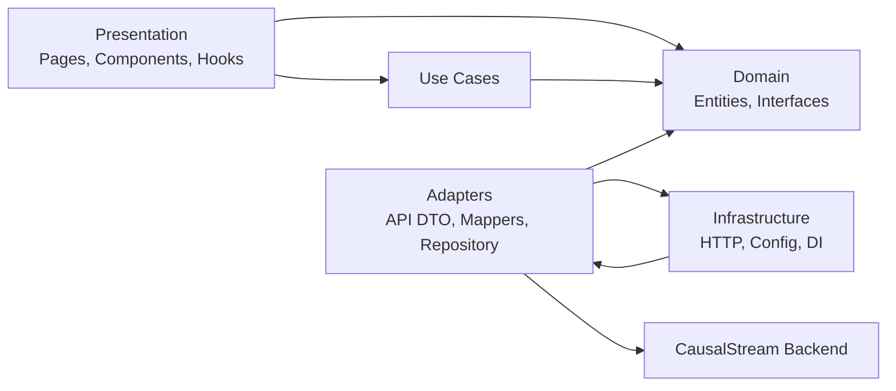
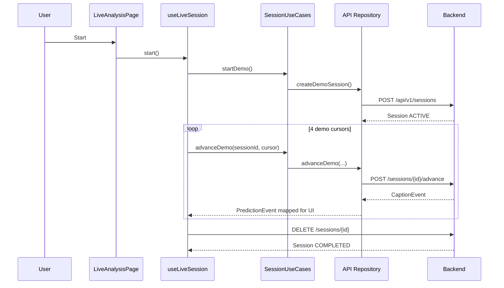

# BÁO CÁO CHI TIẾT HỆ THỐNG FRONTEND CAUSALSTREAM

**Phiên bản báo cáo:** 1.0  
**Ngày đánh giá:** 13/10/2026  
**Phạm vi:** `frontend-web/`  
**Trạng thái sản phẩm:** Prototype tích hợp Backend Demo, chưa phải bản production hoàn chỉnh

---

## 1. Tóm tắt điều hành

Frontend CausalStream là một ứng dụng React Single Page Application phục vụ hai nhóm trải nghiệm:

1. **Chế độ nghiên cứu:** theo dõi phiên phân tích, caption events, lịch sử, model và trạng thái hệ thống.
2. **Chế độ hỗ trợ:** giao diện camera và phản hồi trực quan dành cho người dùng cuối.

Hệ thống hiện đã chuyển từ cấu trúc một file lớn sang kiến trúc phân lớp gần với Clean Architecture. Các luồng Live Demo, History, System Status và Current Model đã có tầng API thật. Những phần chưa có contract backend tương ứng vẫn dùng dữ liệu mock và được gắn nhãn ở phần lớn màn hình.

### Đánh giá tổng quan

| Hạng mục | Trạng thái | Nhận xét |
|---|---|---|
| Giao diện theo mockup | Tốt | Bám sát palette xanh sáng, card, typography và navigation tham chiếu |
| Kiến trúc source | Tốt | Đã tách Domain, Use Cases, Adapters, Infrastructure và Presentation |
| Live Demo API | Hoạt động | Đã kiểm thử chuỗi `WAIT → EMIT → REVISE → WITHDRAW` |
| History API | Hoạt động | Đọc session và caption ledger từ backend |
| System API | Hoạt động | Đọc backend status, AI status và số phiên active |
| AI thật / Live inference | Chưa sẵn sàng | Camera mới là preview; chưa gửi frame khi real model chưa ready |
| Video analysis | Demo | Chọn và phát video local, kết quả vẫn là mock |
| Settings | Demo | Control có giao diện nhưng chưa lưu cấu hình |
| Automated tests | Thiếu | Có Vitest/RTL trong dependencies nhưng chưa có test files |
| Production readiness | Chưa đạt | Thiếu auth, test coverage, telemetry, API caching và hoàn thiện accessibility |

---

## 2. Quy mô codebase

Tại thời điểm báo cáo:

- Khoảng **3.914 dòng source** TypeScript, TSX và CSS.
- **35 file source** trong `src/`.
- Stylesheet chính có **1.687 dòng**.
- 11 routes ứng dụng, bao gồm Not Found.
- 5 dependencies runtime chính: React, React DOM, React Router, Lucide React và Recharts.

### Công nghệ sử dụng

| Nhóm | Công nghệ |
|---|---|
| UI framework | React 18.3 |
| Ngôn ngữ | TypeScript strict mode |
| Build tool | Vite 6 |
| Routing | React Router DOM 6 |
| Icons | Lucide React |
| Charts | Recharts |
| Styling | CSS thuần với CSS custom properties |
| Test tooling | Vitest, React Testing Library, jest-dom |
| API transport | Native Fetch thông qua `HttpClient` tập trung |

### Scripts

```bash
npm run dev       # Vite development server
npm run build     # TypeScript check + Vite production build
npm run preview   # Preview production build
npm run test      # Vitest
```

---

## 3. Kiến trúc tổng thể

Frontend áp dụng dependency direction sau:



> Lưu ý: `CausalStreamApiRepository` nhận `HttpClient` từ composition root trong `infrastructure/di`. Domain không import React, Fetch hay framework bên ngoài.

### Cấu trúc thư mục

```text
src/
├── app/
│   ├── App.tsx
│   └── AppErrorBoundary.tsx
├── domain/
│   ├── entities/analysis.ts
│   └── interfaces/CausalStreamRepository.ts
├── use-cases/
│   ├── predictions/exportPredictions.ts
│   └── sessions/SessionUseCases.ts
├── adapters/
│   ├── api/contracts.ts
│   ├── mappers/causalStreamMapper.ts
│   ├── mock/causalStreamMockData.ts
│   └── repositories/CausalStreamApiRepository.ts
├── infrastructure/
│   ├── config/appConfig.ts
│   ├── di/container.ts
│   └── http/HttpClient.ts
└── presentation/
    ├── components/
    ├── features/
    ├── hooks/
    ├── layout/
    └── styles/
```

### Trách nhiệm từng lớp

#### Domain

- Chứa các model frontend: `PredictionEvent`, `AnalysisSession`, `ModelInfo`, `SystemStatus`.
- Phân biệt UI decision `WAIT/SPEAK/UPDATE` với caption decision backend `WAIT/EMIT/REVISE/WITHDRAW`.
- Định nghĩa `CausalStreamRepository`, là contract duy nhất mà use case cần biết.

#### Use Cases

- `SessionUseCases`: start, advance, pause, resume và complete demo session.
- `exportPredictions`: xuất dữ liệu prediction sang JSON hoặc CSV.

#### Adapters

- Khai báo DTO đúng với schema FastAPI dạng snake_case.
- Mapper chuyển DTO thành entity frontend dạng camelCase.
- `CausalStreamApiRepository` triển khai toàn bộ REST calls.
- `causalStreamMockData` cung cấp dữ liệu presentation cho các phần chưa có API.

#### Infrastructure

- Đọc `VITE_API_BASE_URL`, mặc định `http://127.0.0.1:8000`.
- HTTP client xử lý timeout 10 giây, abort, JSON parsing và chuẩn hóa error.
- DI container tạo singleton repository cho ứng dụng.

#### Presentation

- Page components chịu trách nhiệm bố cục.
- Hooks điều phối side effects và UI state.
- Shared components cung cấp card, button, status badge, camera mock, timeline và table.
- Routes được lazy-load để chia bundle theo màn hình.

---

## 4. Routing và chức năng từng màn hình

| Route | Màn hình | Nguồn dữ liệu | Trạng thái |
|---|---|---|---|
| `/` | Home | Mock/static | Hoàn thiện giao diện |
| `/live` | Live Analysis | Backend Demo API + camera preview | Tích hợp một phần |
| `/video-analysis` | Video Analysis | File local + mock predictions | Demo |
| `/history` | Session History | Backend API | Tích hợp thật |
| `/models` | Model Comparison | Current Model API + mock benchmark | Hybrid |
| `/experiments/:id` | Experiment Details | Mock benchmark | Demo |
| `/system` | System Dashboard | System API + mock time-series | Hybrid |
| `/settings` | Settings | Static local controls | Demo |
| `/assistive` | Assistive Mode | Mock events | Demo |
| `/assistive/history` | Assistive History | Mock events | Demo |
| `/assistive/settings` | Assistive Settings | Static controls | Demo |
| `*` | Not Found | Static | Hoàn thiện |

### 4.1 Home

Chức năng hiện có:

- Hero giới thiệu CausalStream.
- Điều hướng sang Assistive Mode và Live Analysis.
- Camera mock bằng HTML/CSS, không dùng ảnh mockup làm background.
- Feature cards mô tả các giá trị chính.

Hạn chế:

- Thanh trạng thái Home vẫn hiển thị tĩnh `AI Server: Online`, `GRU-v1`, `185 ms`.
- Trạng thái này có thể mâu thuẫn với `/system` khi AI Service thực tế đang offline.

### 4.2 Live Analysis

Đây là luồng tích hợp backend hoàn chỉnh nhất.



Hỗ trợ:

- Tạo demo session `cup_interaction`.
- Advance tuần tự với `expected_cursor`.
- Pause/resume/stop qua backend.
- Abort request khi component unmount hoặc trạng thái thay đổi.
- Hiển thị session ID, status, event count và model version.
- Camera preview qua `getUserMedia`.
- Lỗi API được hiển thị bằng mã lỗi backend.

Giới hạn:

- `DEMO_EVENT_COUNT = 4` và delay `1.400 ms` đang hard-code trong hook.
- Camera preview chưa được chụp frame và gửi tới `/frames`.
- Overlay detection trên camera là minh họa tĩnh.
- Caption event không có confidence nên UI hiển thị `N/A`.

### 4.3 Video Analysis

Hỗ trợ:

- Chọn hoặc kéo-thả MP4, WebM, MOV.
- Tạo object URL và phát video bằng native `<video>`.
- Seek tới các mốc minh họa.
- Revoke object URL khi thay file hoặc unmount.
- Export mock predictions sang JSON/CSV.

Giới hạn:

- Không upload video tới backend.
- Nút phân tích chỉ dùng timeout 900 ms.
- Kết quả không được suy luận từ video đã chọn.
- UI ghi tối đa 500 MB nhưng chưa validate kích thước file.

### 4.4 History

Hỗ trợ:

- Đọc danh sách session từ `GET /api/v1/sessions`.
- Đọc caption events hoặc predictions theo session.
- Tìm kiếm theo nội dung.
- Lọc theo UI decision hoặc caption decision.
- Hiển thị session status, timestamps, model version, cursor và timeline.
- Có AbortController khi đổi session hoặc rời trang.

Đặc điểm contract:

- Event `WAIT` được frontend hiển thị trong phiên live nhưng backend demo không lưu vào caption ledger.
- Vì vậy một demo gồm 4 event có thể chỉ hiện 3 event trong History: `EMIT`, `REVISE`, `WITHDRAW`.

### 4.5 Models

- `GET /api/v1/models/current` cung cấp model name, version, provider, readiness và supported modes.
- Nếu AI Service offline, frontend hiển thị lỗi `AI_SERVICE_UNAVAILABLE` thay vì giả lập model thật.
- Bảng benchmark, charts và recommendation vẫn là mock data và được gắn nhãn rõ.

### 4.6 Experiment Details

- Hiển thị cấu hình, metrics, confusion matrix, training log và charts.
- Route xác thực experiment ID dựa trên mock dataset.
- Tất cả kết quả nghiên cứu hiện là dữ liệu minh họa, chưa lấy từ backend.

### 4.7 System Dashboard

Dữ liệu thật:

- Backend online/offline.
- AI Service online/offline.
- Số session active.
- Model version/readiness nếu Model API truy cập được.

Dữ liệu mock:

- CPU, RAM, GPU.
- Response time time-series.
- Các biểu đồ đều có nhãn demo vì backend chưa cung cấp telemetry time-series.

### 4.8 Settings

- Có các nhóm camera, FPS, model, voice, notification, privacy và profile.
- Control hiện chủ yếu mang tính trình diễn.
- Toggle là visual component, chưa phải input tương tác đầy đủ.
- Nút lưu, khôi phục, đổi mật khẩu và đăng xuất chưa có behavior/backend.

### 4.9 Assistive Mode

- Camera mock, trạng thái WAIT/SPEAK/UPDATE và confidence bar.
- Cho phép đổi thủ công giữa ba trạng thái UI.
- Chưa dùng session backend, speech synthesis hoặc camera inference.

---

## 5. API integration

### Endpoint đang được frontend sử dụng

| Method | Endpoint | Mục đích |
|---|---|---|
| `POST` | `/api/v1/sessions` | Tạo Demo session |
| `POST` | `/api/v1/sessions/{id}/advance` | Lấy caption event kế tiếp |
| `POST` | `/api/v1/sessions/{id}/pause` | Pause session |
| `POST` | `/api/v1/sessions/{id}/resume` | Resume session |
| `DELETE` | `/api/v1/sessions/{id}` | Complete session |
| `GET` | `/api/v1/sessions` | Danh sách session |
| `GET` | `/api/v1/sessions/{id}/caption-events` | Caption ledger |
| `GET` | `/api/v1/sessions/{id}/predictions` | Prediction history cho Live mode |
| `GET` | `/api/v1/models/current` | Model hiện hành |
| `GET` | `/api/v1/system/status` | Trạng thái Backend/AI |

### Endpoint backend chưa được UI khai thác

| Endpoint | Cơ hội tích hợp |
|---|---|
| `POST /api/v1/sessions/{id}/frames` | Gửi frame camera cho Live inference |
| `GET /api/v1/sessions/{id}` | Đồng bộ lại session riêng lẻ sau reconnect |
| `GET /api/v1/sessions/{id}/captions` | Hiển thị caption hiện hành và version history |
| `/healthz`, `/readyz` | Health/readiness indicator chi tiết hơn |

### Mapping quyết định

| Backend caption decision | UI decision | Ý nghĩa UI |
|---|---|---|
| `WAIT` | `WAIT` | Tiếp tục quan sát |
| `EMIT` | `SPEAK` | Phát caption mới |
| `REVISE` | `UPDATE` | Sửa caption đã phát |
| `WITHDRAW` | `UPDATE` | Thu hồi caption trước đó |

Frontend vẫn lưu `captionDecision` gốc để không mất ý nghĩa nghiệp vụ khi map sang badge UI cũ.

---

## 6. State management

Frontend chưa dùng Zustand, Redux hoặc TanStack Query. State được chia như sau:

| Loại state | Cách quản lý |
|---|---|
| Route state | React Router |
| Local UI state | `useState` |
| Async lifecycle | Custom hooks + `useEffect` |
| API cancellation | AbortController |
| Refresh | Revision counter trong hook |
| Server cache | Chưa có |
| Form state | Native uncontrolled controls |

### Custom hooks chính

- `useLiveSession`: điều phối session lifecycle và demo event loop.
- `useSessionHistory`: tải session list và events theo selection.
- `useBackendOverview`: tải đồng thời system status và model info bằng `Promise.allSettled`.

Ưu điểm:

- Logic async không nằm trực tiếp trong JSX page.
- Có cleanup và cancellation.
- API error được chuẩn hóa.

Hạn chế:

- Không cache, deduplicate hoặc retry request.
- Không có stale time hay background refetch.
- Loading/error state đang được triển khai thủ công ở từng hook.
- Chưa có optimistic update hoặc reconnect strategy.

---

## 7. UI system và responsive design

### Typography

Font stack hiện tại:

```css
Inter, ui-sans-serif, system-ui, -apple-system, BlinkMacSystemFont, "Segoe UI", sans-serif
```

Ứng dụng chưa tải Inter từ local asset hoặc CDN; nếu máy không có Inter, browser dùng system font kế tiếp.

### Design tokens

Palette chính:

- Background: `#f4faff`
- Primary blue: `#1478f2`
- Dark blue: `#075fd0`
- Teal: `#10c8a0`
- Success: `#10b981`
- Warning: `#f59e0b`
- Error: `#ef4444`
- Text: `#061b55`
- Border: `#d8e8fb`

Các token được định nghĩa tại `:root`, nhưng spacing, typography scale và z-index chưa được token hóa đầy đủ.

### Breakpoints

- Desktop/tablet adaptation: `max-width: 1280px`.
- Mobile adaptation: `max-width: 760px`.
- Header chuyển sang mobile menu.
- Grid nhiều cột chuyển thành một cột trên màn hình nhỏ.

### Shared components

- `PageShell`, `PageHeader`
- `Card`, `CardTitle`
- `Button`, `Pill`, `StatusBadge`
- `StatCard`, `ChartCard`, `InfoRows`
- `CameraMock`, `PredictionPanel`, `Timeline`, `PredictionTable`
- Settings controls và system service table

---

## 8. Error handling và resilience

### HTTP layer

`HttpClient` cung cấp:

- Base URL tập trung.
- Timeout 10 giây.
- Kết hợp external abort signal với timeout signal.
- Parse JSON tập trung.
- `ApiError` gồm `code`, `message`, `status`, `details`.
- Phân biệt network, timeout/abort, invalid response và backend errors.

### React layer

`AppErrorBoundary`:

- Bắt lỗi render tree.
- Nhận diện lỗi dynamic import/chunk loading.
- Cho phép người dùng reload phiên bản bundle mới.

Giới hạn:

- Error boundary không bắt lỗi trong async callbacks; các hook phải tự xử lý.
- Chưa có logging service hoặc error reporting tập trung.
- Chưa có retry UI cho từng request ngoài nút Refresh/Start.

---

## 9. Performance

Các tối ưu đang có:

- Lazy loading theo route bằng `React.lazy` và `Suspense`.
- Tách chart-heavy routes khỏi initial route.
- Cleanup timer, media stream và object URL.
- Abort request khi unmount hoặc đổi dependency.

Kết quả build gần nhất:

- Main application chunk: khoảng **180 kB**, gzip khoảng **59 kB**.
- Recharts/LineChart chunk: khoảng **394 kB**, gzip khoảng **108 kB**.
- CSS: khoảng **21 kB**, gzip khoảng **5,5 kB**.

Rủi ro:

- Recharts vẫn là chunk lớn nhất.
- Stylesheet đơn 1.687 dòng sẽ khó scale và dễ phát sinh selector coupling.
- Một số feature files còn nhiều import không sử dụng do quá trình refactor ban đầu.
- Chưa bật `noUnusedLocals` và `noUnusedParameters`.

---

## 10. Accessibility

Điểm tốt:

- Có semantic `header`, `nav`, `main`, headings và tables.
- Mobile menu và brand có accessible label.
- Native input, select, video và checkbox được sử dụng ở nhiều vị trí.
- Màu trạng thái thường có thêm text label.

Khoảng trống:

- Một số icon-only buttons chưa có `aria-label`, ví dụ nút copy caption.
- Toggle visual dùng `<span>` nên chưa keyboard-accessible.
- Một số select không có label liên kết rõ ràng.
- Table chưa có `<caption>`.
- Chưa có focus management khi route thay đổi hoặc lỗi xuất hiện.
- Chưa có kiểm thử contrast, keyboard-only và screen reader.

---

## 11. Security và privacy

Hiện trạng:

- Chưa có authentication hoặc authorization phía frontend.
- Không lưu token hoặc credential.
- Camera chỉ được yêu cầu khi người dùng bấm Camera Preview.
- MediaStream được dừng khi unmount.
- Video local dùng object URL và được revoke.
- API URL lấy từ biến môi trường build-time.

Cần bổ sung trước production:

- Authentication flow và route protection.
- Token refresh/logout handling nếu backend áp dụng auth.
- Content Security Policy và security headers tại hosting layer.
- Quy tắc upload size/type thống nhất với backend.
- Privacy disclosure cho camera/video.
- Không hiển thị dữ liệu profile hard-code như dữ liệu thật.

---

## 12. Testing và quality gates

### Hiện trạng

- `npm run build` thành công.
- TypeScript strict mode đang bật.
- Đã kiểm thử thủ công end-to-end với Backend Demo:
  - Tạo session.
  - Nhận đủ 4 demo events.
  - Session chuyển `COMPLETED`.
  - History đọc lại 3 caption mutations đã lưu.
- Vitest và React Testing Library đã được cài.
- **Chưa có test files frontend.**

### Test suite nên bổ sung

1. Unit test cho mapper caption decision.
2. Unit test cho `HttpClient` error normalization.
3. Unit test cho `SessionUseCases` với mock repository.
4. Hook integration test cho start/pause/resume/complete.
5. Component test cho Live error/loading states.
6. Component test cho History filtering.
7. Playwright E2E cho Live Demo → History.
8. Accessibility test bằng axe-core.

---

## 13. Các vấn đề và rủi ro hiện tại

### Mức ưu tiên cao

1. **Thiếu automated tests:** thay đổi API hoặc state machine có thể gây regression mà build không phát hiện.
2. **Live scenario hard-code:** frontend biết trước có đúng 4 events; nên backend trả scenario metadata hoặc completion signal.
3. **Home hiển thị trạng thái tĩnh:** có thể báo AI Online trong khi `/system` báo Offline.
4. **Chưa có Live frame pipeline:** camera preview chưa tạo giá trị inference thật.
5. **Không có auth:** chưa phù hợp với môi trường nhiều người dùng hoặc dữ liệu nhạy cảm.

### Mức ưu tiên trung bình

1. Video Analysis chưa nối upload/inference API.
2. Settings chưa có persistence và validation.
3. Assistive Mode chưa nối backend và speech output.
4. Không có server-state cache/retry.
5. CSS monolith và unused imports làm tăng maintenance cost.
6. Model API phụ thuộc AI Service; khi AI offline không có metadata fallback cho local demo model.

### Mức ưu tiên thấp

1. Chuẩn hóa copy Việt/Anh trong UI.
2. Hoàn thiện skeleton loading thay vì text loading.
3. Tách design tokens thành module riêng.
4. Bổ sung empty states có hướng dẫn hành động.

---

## 14. Roadmap đề xuất

### Giai đoạn 1: Ổn định nền tảng

- Bổ sung test cho mapper, repository, use cases và hooks.
- Bật ESLint cùng `noUnusedLocals`.
- Đồng bộ Home status với `useBackendOverview`.
- Backend trả `scenario_length` hoặc `completed` khi demo kết thúc.
- Tách API error presentation thành component dùng chung.

### Giai đoạn 2: Tích hợp AI thật

- Tạo frame capture service từ webcam.
- Throttle FPS phía client.
- Gửi multipart frames tới `/sessions/{id}/frames`.
- Hiển thị latency, confidence và model version thật.
- Thêm reconnect/recovery cho session bị gián đoạn.

### Giai đoạn 3: Hoàn thiện workflows

- Video upload và batch analysis thực tế.
- Settings API và persistence.
- Assistive Mode dùng session thật và Web Speech API/TTS backend.
- Pagination và query filters phía server cho History.
- Current caption view dựa trên `/captions`.

### Giai đoạn 4: Production readiness

- Authentication/authorization.
- TanStack Query hoặc server-state abstraction tương đương.
- E2E suite và accessibility audit.
- Monitoring, frontend telemetry và source maps an toàn.
- CSP, secure deployment config và CI quality gates.

---

## 15. Hướng dẫn vận hành local

### Backend

```bash
cd backend
.venv/bin/alembic upgrade head
.venv/bin/python -m uvicorn app.main:app --host 127.0.0.1 --port 8000
```

### Frontend

```bash
cd frontend-web
cp .env.example .env
npm install
npm run dev -- --port 5173
```

URL mặc định:

- Frontend: `http://localhost:5173`
- Backend: `http://127.0.0.1:8000`
- API base URL: `VITE_API_BASE_URL=http://127.0.0.1:8000`

### Production build

```bash
cd frontend-web
npm run build
npm run preview
```

---

## 16. Kết luận

Frontend hiện tại đã có nền tảng kiến trúc tốt cho giai đoạn tiếp theo: route splitting, domain model rõ ràng, repository abstraction, HTTP error normalization và các hooks tách biệt khỏi UI. Live Demo và History đã chứng minh được luồng frontend-backend end-to-end.

Tuy nhiên, sản phẩm vẫn đang ở mức **prototype tích hợp**, chưa phải production system. Giá trị ưu tiên cao nhất tiếp theo là loại bỏ trạng thái giả gây hiểu nhầm, bổ sung automated tests, đưa scenario metadata về backend và triển khai frame/video inference thật. Khi bốn điểm này được hoàn thiện, kiến trúc hiện có đủ khả năng mở rộng mà không cần thay đổi nền móng lớn.
